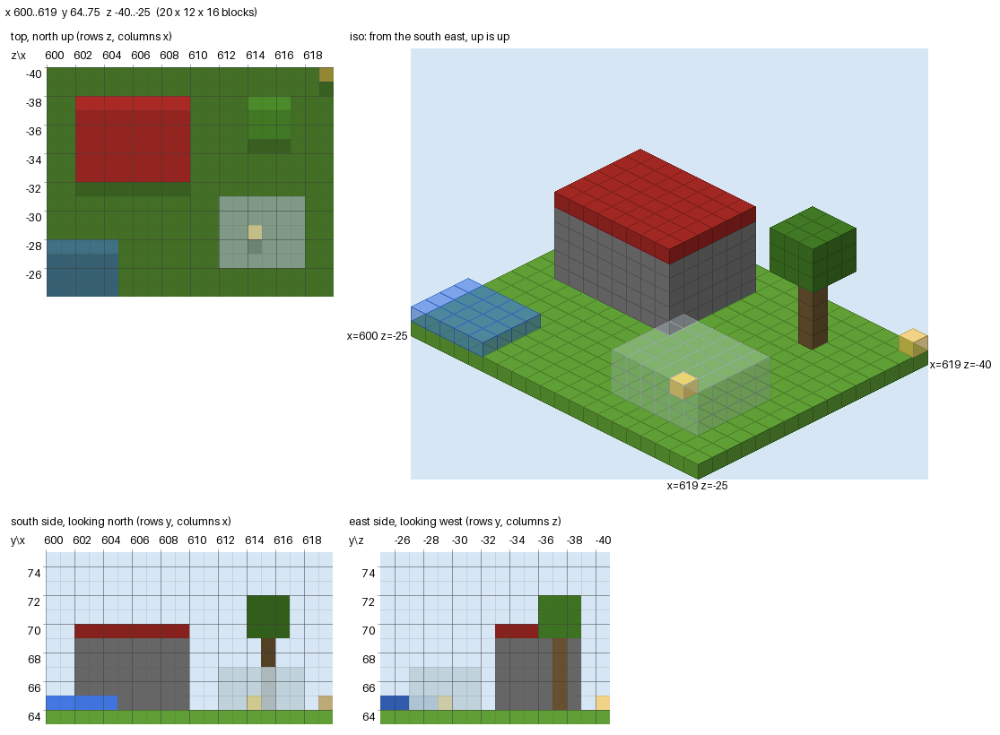

.. _render_howto:

Render a Build to an Image
==========================

mciwb can draw a region of the world to a PNG image, so you can see what a
script built without joining the game. This is especially useful for AI
agents that write build scripts: they can read the image and check their work.
The :ref:`Claude Code skill <claude_skill>` uses it to check each build.

    ``top``, ``iso``, ``south`` and ``east`` views of a small scene: a stone
    brick hut with a red roof, a glass box with a gold block inside, a
    tree and a pool of water

From the command line
---------------------

Give two opposite corners of the region, X Y Z then X Y Z::

    mciwb render 620 60 -1670 645 90 -1645

Or give its centre and size::

    mciwb render --centre 632 73 -1658 --size 24 20 24

Either way the image is written to ``render.png``. These options change what
is drawn:

``--view``
    The view to draw. Repeat it for several views side by side. The default
    is ``--view top --view iso``.
``--output``
    The PNG file to write.
``--scale``
    Pixels per block, for every view. By default each view has its own
    scale, chosen to make it about 512 pixels across (at most 16 pixels per
    block), and shrunk if needed to keep the whole image under 1500 pixels
    wide.
``--no-labels``
    Leave out the titles, coordinate labels and grid lines.

The views
---------

``top``
    A plan of the region, north up, showing the highest block in each column.
    Higher blocks are lighter. A block that is higher than its northern
    neighbour has a light edge, and a lower one has a dark edge.
``north``, ``south``, ``east``, ``west``
    Elevations: the region seen from that side. For example ``south`` looks
    north at the south face, with x across and y up. Nearer blocks are
    lighter.
``iso``
    A 3D isometric view from above the south east corner. ``iso_ne``,
    ``iso_nw`` and ``iso_sw`` look from the other corners.

Each view has its world coordinates along the top and left edges. Each label
is centred on its row or column of blocks, and a grid line runs along the
leading edge of that row or column. Isometric views label three corners of the
region's footprint instead. Translucent blocks (glass, water, ice) and small
ones (torches, flowers, fences, panes) are drawn partly transparent, so the
blocks behind them show through.

From Python
-----------

In ``mciwb run`` scripts and ``mciwb shell``, use the ``world`` object::

    grid = world.render(Vec3(620, 60, -1670), Vec3(645, 90, -1645), "hut.png",
                        views=["top", "iso", "south"])
    print(grid.counts())    # e.g. {'minecraft:stone_bricks': 412, ...}

``world.scan(start, end)`` reads the blocks without drawing them. It returns a
`BlockGrid`, which you can index with a world position (``grid[pos]`` is a
block name) and count with ``grid.counts()``. This is a quick way to check
that a build contains what it should.

For other servers, or to draw the same blocks several ways, use the functions
`mciwb.render.scan` and `mciwb.render.render` directly::

    from mciwb.render import render, scan

    vol = Volume.from_corners(start, end)
    grid = scan(vol, Path("~/mciwb-server/world").expanduser(), get_client())
    render(grid, views=["top", "west"], scale=8).save("plan.png")

How the blocks are read
-----------------------

There are two ways to read the blocks:

From the world files
    This is fast. mciwb asks the server to save its changes to disk
    (``save-all flush``), then reads the region (``.mca``) files of the world
    folder directly. It needs the world folder on this machine, as it is for
    the server that ``mciwb start`` runs: ``mciwb render`` looks in
    ``~/mciwb-server/world``. Use ``--folder`` if you gave ``mciwb start`` a
    different folder.
Over RCON
    This works with any server, local or remote, but it asks the server for
    one block at a time. It is used when there is no world folder, or with
    ``mciwb render --rcon``. It is limited to 32768 blocks.

Pass the ``--port`` and ``--password`` that you gave to ``mciwb start``,
just as for ``mciwb backup``. Chunks that have never been generated read as
air. Only block names are read: block states, such as which way stairs face,
are not.

In a script, ``world.scan`` and ``world.render`` read the world files of
``world.world_folder``. mciwb sets it for the server of ``mciwb start``,
whatever its ``--port``, when it uses the default ``--folder``
(``~/mciwb-server``). Otherwise it is ``None`` and the blocks are read over
RCON, so set it yourself::

    from pathlib import Path

    world.world_folder = Path("/my/server/world")

Limits and timings
------------------

Measured on a laptop with a synthetic world (reading the files, then drawing
one view):

.. list-table::
    :header-rows: 1

    * - region (x, y, z)
      - blocks
      - read files
      - ``top``
      - ``south``
      - ``iso``
    * - 64 x 64 x 64
      - 262,144
      - 0.03 s
      - 0.01 s
      - 0.01 s
      - 0.06 s
    * - 128 x 128 x 128
      - 2.1 million
      - 0.05 s
      - 0.01 s
      - 0.01 s
      - 0.2 s
    * - 256 x 384 x 256
      - 25 million
      - 0.2 s
      - 0.5 s
      - 0.8 s
      - 2.8 s
    * - 512 x 384 x 512
      - 100 million
      - 0.8 s
      - 1.9 s
      - 2.7 s
      - 10 s

On the GitHub Actions test server, reading the files of 96 x 384 x 96
blocks of a flat world took 0.06 s. Over RCON, a 16 x 16 x 16 region (4096
blocks) took 2.6 s, about 0.6 ms per block. At that rate the RCON limit of
32768 blocks takes about 20 s, so RCON is only practical for small builds.

A region takes 2 bytes of memory per block, so 100 million blocks need about
200 MB. The isometric view is the slowest, because it draws each visible block
face in Python. For an AI agent, keep images below about 1500 pixels across:
larger images are scaled down before the model sees them. The automatic scale
keeps images within this width; an explicit ``--scale`` does not.
One build, or a region up to about 100 blocks across, gives clear images
with the automatic scale: beyond that, each block is too few pixels to read.

Colours
-------

mciwb does not include Minecraft's textures. Each block has one colour, close
to the average colour of its texture, from ``mciwb.palette``. The palette has a
table of common blocks, plus rules for the families of blocks: the 16 dye
colours (``red_wool``, ``blue_concrete``, ``lime_stained_glass`` ...), wood
types, stairs, slabs and walls made from other blocks, copper, and ores.
Blocks that it does not know get a muted colour made from their name.

To change a colour for every render::

    from mciwb.palette import set_colour
    set_colour("minecraft:gold_block", (255, 215, 0))

or for one render, pass a `Palette` (colours are (r, g, b) or (r, g, b,
alpha), where an alpha below 255 makes the block see-through)::

    from mciwb.palette import Palette
    render(grid, palette=Palette({"mymod:crystal": (200, 120, 255, 128)}))
