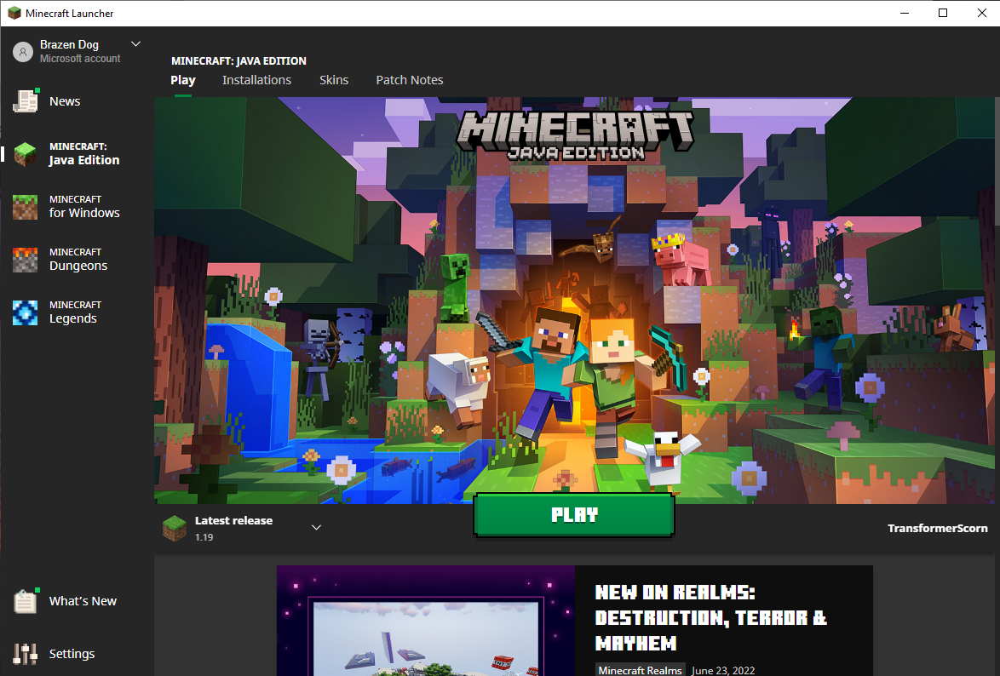
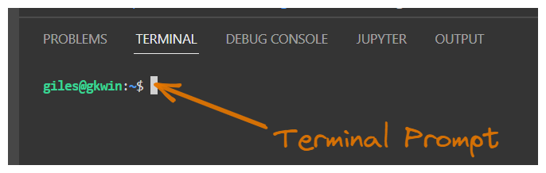
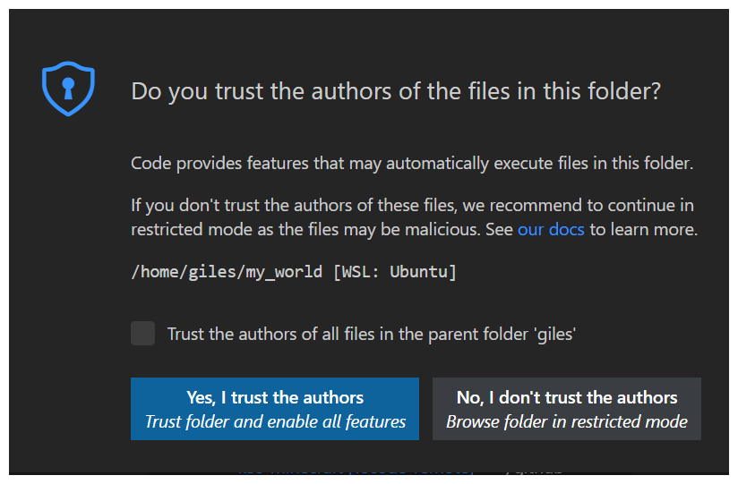
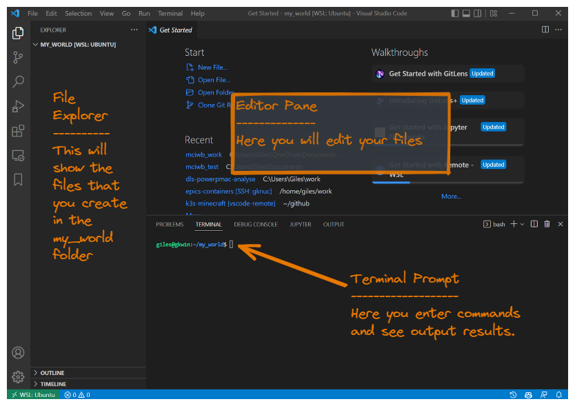

Installation
============

Introduction
------------

For the first tutorial we are going to prepare your computer for the rest
of the tutorials. To do so we need to install the following software:

- The Minecraft Java Client (with Minecraft account purchase)
- Podman
- Visual Studio Code
- Python
- Minecraft Interactive World Builder Python package

.. warning::

    The tutorials for this project are intended to be accessible for
    complete beginners. However, this first step of getting all of the
    software installed may need a little bit of knowledge of the basics of
    your operating system.

    For this Setup Tutorial, I recommend that novices get a little help from
    someone with computer experience. This setup tutorial need only
    be done once (per computer) and the remaining tutorials should not
    require prior knowledge.

The Minecraft Java Client
-------------------------

If you already have the Minecraft Java Client installed proceed to `podman`.

You will need to purchase a license for Minecraft from Microsoft.

Go to this site to buy your copy, if you do not already have one:

    https://www.minecraft.net/en-us/store/minecraft-java-bedrock-edition-pc

Once you have a license, download the Java client to
the computer where you will be trying out MCIWB.
This is the download link for the Java client:

        https://www.minecraft.net/en-us/download

Microsoft has now bundled the Java and Bedrock editions together.
We are using the Java edition here but this project could be adapted to
work for either in future.

When you start Minecraft you will be asked to login with your Microsoft details,
note that the 'Mojang Login' option is only for legacy users who have not
yet migrated.

When you have successfully launched the Minecraft Launcher, you will see a
a screen like the following. Leave this screen open and move on to the rest
of the tutorial. We will come back here and connect to a Minecraft server in a
later tutorial.

.. _podman:

Podman
------

Podman is a tool that allows you to run your Minecraft Server in a container.
This makes it easy to run and avoids having to manually install and
maintain the server code.
You do not need to understand too much about this since MCIWB will automatically
use podman on your behalf.

MCIWB talks to Podman through its service socket, so as well as installing
Podman you need to switch that service on once.

Linux:
    Install podman with your package manager, e.g. on Ubuntu::

        sudo apt install podman

    Then switch on the Podman service for your user. It starts again
    automatically each time you log in::

        systemctl --user enable --now podman.socket

    To have your Minecraft server start again after a reboot, also enable::

        systemctl --user enable podman-restart.service

    Install instructions for other Linux distributions are here:
    https://podman.io/docs/installation#installing-on-linux

Windows:
    On Windows MCIWB runs inside the Windows Subsystem for Linux (WSL2), with
    Ubuntu. Install WSL2 and Ubuntu 24.04 LTS (or later) by typing
    this into a Windows PowerShell or Command Prompt::

        wsl --install -d Ubuntu-24.04

    Then open the Ubuntu terminal from the start menu and follow the Linux
    instructions above to install Podman inside Ubuntu.

    ``systemctl --user`` needs systemd to be enabled in WSL. Recent versions
    of WSL enable it by default for Ubuntu. If ``systemctl`` reports that
    systemd is not running, add these lines to the file ``/etc/wsl.conf`` in
    Ubuntu (e.g. with ``sudo nano /etc/wsl.conf``)::

        [boot]
        systemd=true

    Then restart WSL by typing ``wsl --shutdown`` into a Windows PowerShell or
    Command Prompt, and open the Ubuntu terminal again.

    (Podman Desktop https://podman-desktop.io is an alternative that runs
    Podman in its own WSL2 machine, but installing Podman inside your Ubuntu
    is simpler for MCIWB.)

MacOS:
    Install Podman Desktop from https://podman-desktop.io and use it to
    create and start a Podman machine (a small Linux virtual machine that
    runs your containers). Or, with Homebrew::

        brew install podman
        podman machine init
        podman machine start

    MCIWB needs to know where the Podman machine's socket is. Add this line
    to the file ``~/.zshrc`` so that it is set in every new terminal::

        export CONTAINER_HOST=unix://$(podman machine inspect --format '{{.ConnectionInfo.PodmanSocket.Path}}')

    The Podman machine must be running before you use MCIWB: start it from
    Podman Desktop, or with ``podman machine start``.

.. _vscode:

Visual Studio Code
------------------

This is the tool we will use to edit our Python code. If you are already
a developer then you can use your preferred IDE instead. The tutorials
will use Visual Studio Code, so if you are new to programming this is
a recommended install.

VSCode is free, open-source software.

This link provides downloads for all flavours of VSCode:

    https://code.visualstudio.com/download

Command Line
------------

From now on we are going to start using the command line. You are free to use
whatever terminal program you like, however I recommend that you use the
integrated terminal inside of Visual Studio Code.

Here we will set up our initial VSCode work folder and get a ``bash``
command line prompt. ``bash`` is the most popular ``shell`` for Linux,
it provides a command line interface to all the utilities and services
on a Linux computer. On Windows we will be using the Linux Subsystem so will
also use ``bash``. On Mac we will be using ``zsh`` but this is pretty similar
to ``bash``.

First open VSCode from the start menu.

.. note::

    **Windows Users: Important**

    We are going to use 'Windows Subsystem for Linux 2' or WSL2.
    Go here first to get VSCode connected to WSL2:
    `wsl2`

Let's create a work folder for use in further tutorials and tell VSCode To
open the folder. We'll call it  ``my_world`` but you are free to use your
own name.

First start a terminal by selecting from the menu bar
``Terminal -> New Terminal``.

The bottom half of your VSCode window will display a ``bash``
prompt like this:

Type the following to make sure you are in in your home directory and then
create a new folder called ``my_world``::

    cd
    mkdir my_world

Now we want to reopen VSCode with the new folder set as its work area.
From the menu bar choose ``File -> Open Folder``. You will see a list of
folders, select ``my_world`` and click OK.

You will be asked if you trust the authors of files in this folder.
You do trust them because they are you! So click
``Yes I trust the authors``.

Now you should see a you VSCode window that looks something like this:

From this point on all commands typed in the console and chosen from VSCode
menus should be the same for Windows, Linux and MacOS. This is because you
now have a bash shell for typing commands.

.. warning::
    There is one caveat here. When directed to install a software package with
    ``sudo apt``, this will only apply if you are using a Debian derived
    OS such as Ubuntu (this also covers Windows WSL2 users).
    Mac, CentOs, Arch based users - I'm hoping you will know the equivalent
    commands. I will supply an appendix for other OSes in future.

Python
------

The Python Programming Language is also free and open-source.
MCIWB needs Python 3.11 or later.

We will use a tool called **uv** to install Python and to manage the Python
packages that we use. Type this command to install uv::

    curl -LsSf https://astral.sh/uv/install.sh | sh

Then close your terminal and open a new one, so that the ``uv`` command is
found. You can check it is working by typing::

    uv --version

You do not need to install Python separately, uv downloads the right
version for you in the next step.

Virtual Environment
-------------------

We are going to create a **Virtual Environment** for our Python packages to
install in. This is a way to keep the packages you install (like mciwb)
separate from the packages you install for other projects.

First create the Virtual Environment by typing (note the leading "."
in the folder name ".venv")::

    cd $HOME/my_world
    uv venv --python 3.13 .venv

Then activate it by typing the following. This command will need to be
repeated each time you restart your terminal or open a new terminal::

    source .venv/bin/activate

Note you can tell you have an active **Virtual Environment** because
your terminal prompt will change to have a leading (.venv) like this::

    (.venv) $

Minecraft Interactive World Builder library
-------------------------------------------

The final component is MCIWB itself. This needs to be added to the
Python environment we already made above. Again, this is free open open-source
software.

Before the next step, let's make sure that we are in the right folder and
that we have the **Virtual Environment** activated::

    cd $HOME/my_world
    source .venv/bin/activate

The cd command stands for ``Change Directory``. This is a command that sets
the current working folder (or directory). This is the default folder
that your commands will work with from now. ``$HOME`` is your default HOME
folder, the folder in which your user keeps their personal files. We already
created the folder ``$HOME/my_world`` earlier and this is where we will store
all of the work we do with MCIWB.

Everything is all set up ready so the following simple command will get
mciwb and install it into the **Virtual Environment**::

    uv pip install git+https://github.com/gilesknap/mciwb.git

.. note::

    This installs the latest mciwb from GitHub. Once the version that
    supports Minecraft 26.x is published to the Python Package Index (PyPI)
    you will be able to use ``uv pip install mciwb`` instead.

Assuming all is well you should be able to verify everything is working
by typing the following::

    mciwb --help

That's all the hard bits done and they only need to be done once.
You can now proceed to the next tutorial.
