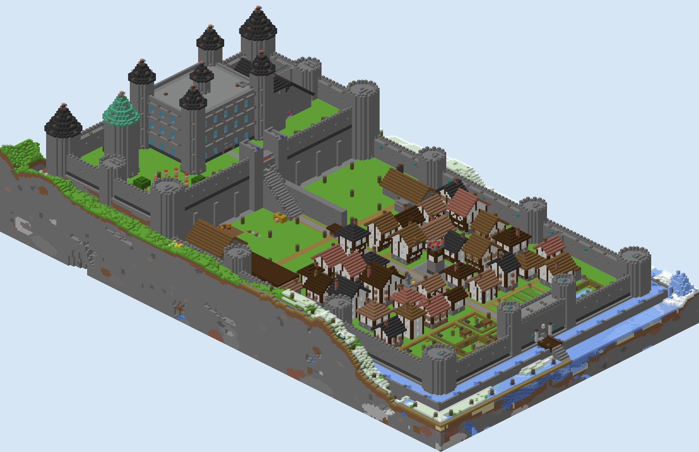

# Castle 2: Fable II

Castle Fable (`examples/castle`) with a lower bailey twice as deep, filled
with a timber-framed village, farm animals in pens and the people who live
there. It reuses castle's modules rather than forking them: castle2 sets a
bigger layout, adds its own stages to castle's and checks them. The plan
is in [PLAN.md](PLAN.md) (gilesknap/mciwb#173), and how far it has got in
[PROGRESS.md](PROGRESS.md).



```
mciwb run build_castle2.py                        # everything, in order
STAGES=village,pens mciwb run build_castle2.py    # just some stages
mciwb run verify_castle2.py                       # castle's checks and castle2's
CHECKS=pens,people mciwb run verify_castle2.py    # some of castle2's checks only
python house_rig.py rig.png                       # every house variant, offline
mciwb run house_rig.py                            # the same in the air over the site
```

`examples/castle` must sit beside this folder. Pass `--server` and
`--port` for a server that is not the `mciwb start` one, and the password
in `$MCIWB_PASSWORD` (or `--password-file`).

## Where and what

The defaults are in `castle2_layout.DEFAULTS` and the environment
overrides them (as castle's): `BAILEY_DEPTH=162`, `ORIGIN=560,68,-190` (a
flat, dry site at x 550..700, z -200..70, ground 62..72), `SPAWN=32,74,-64`,
`NAME=Fable II`, `BANNER=cyan`. Import `castle2_layout` before any of
castle's modules: it sets these before castle's layout reads them.

In castle's local coordinates (x east, z south, y above the bailey floor)
the bailey is x 0..120, z 65..226, in three parts:

| Part | Local z | What |
| --- | --- | --- |
| North | 65..120 | castle's barracks, stables, smithy, well and cross paths, as in castle |
| Village | 120..190 | the market square (x 44..76, z 147..165) with a market cross and a bell, a ring of lanes, 32 houses |
| South | 190..226 | the pens, the allotments, a frog pond, castle's market stalls by the gate |

The second pair of mid-wall towers stands at z 164. Everything under the
bailey (dungeons, catacombs, lower treasury) is where castle has it,
counted from the junction: it hangs off the smithy's hatch and the well's
tunnel.

## Stages

castle2 runs castle's stages (see castle's README), with its own
furniture in castle's rooms (`rooms.py`) and these of its own:

- `village` (after `bailey_buildings`): the lanes, the square, the market
  cross and the houses of `castle2_layout.HOUSES`.
- `pens` (after `village`): seven pens of animals (cows, sheep, pigs,
  chickens, goats, rabbits, frogs), the allotments with a scarecrow and
  bee hives by the upper ward's garden.
- `people` (after castle's `details`): the castle's people (king and queen
  on their thrones, cook, librarian, monk, alchemist, smith, jailer), the
  shopkeepers with trades that match their shops, drinkers in the tavern,
  villagers and children round the square, cats, loose chickens, a copper
  golem at the market and guards with spears on the walls.
- `furnish` (after `dungeons`): more detail in the alchemist's tower, the
  dungeon, the vault and the winch room.
- `machines` (after `furnish`, `machines_upper.py` and `organ.py`) and
  `bailey_machines` (after `pens`, `machines_bailey.py`): phase 6's ten
  machines, each opening a secret (`castle2_layout.SECRETS`).
- `clues` (after `people`, `clues.py`): the clue trail. Books on lecterns
  and in the secrets' chests lead from the tavern down to the inner vault,
  and Mercator the cartographer sells a chart with a hint for each secret.
  Rebuild it after `machines`, `bailey_machines` or `people`.
  `python guide2.py` prints the guide, with rumours and then the whole
  trail as spoilers.
- `play` (after `clues`, `play.py`): what makes the castle a game for
  more than one visitor (see "Playing" below). It builds the Steward's
  bell in the gatehouse's winch room, a notice board inside the gate, the
  chamber of the restless dead south of the ossuary, four caches behind
  weak walls and the main vault's lesser hoard, and plans the command
  blocks that run them. Rebuild it after castle's `vault`, `gatehouse` or
  `dungeons`, or `bailey_machines`.
- `protect` (last, `protect.py`): what keeps the castle as built while
  visitors play in it. Hidden command blocks (in the command bank, a box
  of stone bricks buried under the upper ward) put survival players in
  adventure mode while they are in the site, and back in survival when
  they leave; and put a book back on the Book of Hours' lectern and the
  three clue lecterns when one is taken. It locks the Engine's hoppers,
  and places every row of the bank, play's included. Rebuild it after
  `machines`, `clues`, `play` or castle's `alchemist`.

Protection that is built where it belongs: every armour stand, item
frame, painting, person, cat, hound, horse and golem is summoned
invulnerable, the stands' armour and the frames' items fixed
(`castle_lib.protected`, so in castle too); each secret room has a way out
from inside (a wooden button, or its own bell, lever, stone button or iron
door); the transmuter's dropper of stars is
locked; the gate has a postern round the portcullis (an iron door with a
button each side, `main_gate.py`); the goats' and frogs' pens have a
barrier lid; the copper that must not age is waxed.

## Playing

A visitor in adventure mode cannot break or place a block, so cannot
farm or mine. What the castle gives them to do (`play.py`, with
`loot.py` for what every container holds):

- **A start.** Hal the Crier stands inside the gate, with a notice board
  across the street: welcome, nothing here can be broken, begin at the
  tavern, buy Mercator's chart. A player's first time through the gate
  brings a word from Hal and a purse of 5 emeralds (once each: the tag
  `castle_560_-190.purse`).
- **Emeralds.** The keepers buy what such a visitor can come by
  (`people.BUYS`): white wool (the tailor and the weaver; the tailor
  sells shears), eggs and milk (the baker; the smith sells a bucket), cod
  and salmon (the butcher; the fletcher sells a fishing rod), rotten
  flesh and bones (the apothecary), spectral arrows (the fletcher).
- **An end to the trail.** The inner vault holds the Founder's chest:
  the nether star, the elytra, the trident, the netherite and the rest
  of the best of castle's vault, with his last word. The main vault
  keeps a lesser hoard.
- **Feedback.** The organ gives a sour low note and smoke for a key that
  starts the tune again and a chime and green sparks for a key in its
  turn (two or three seconds after the key: as long as its works take).
  Three lamps on the archery butt show a hit, a hit in the inner half
  and a near miss. The lectern lock opens only when the book has lain
  open at its page for 4 seconds: someone leafing through for the page
  that works turns past it.
- **The restless dead.** Through an iron door in the ossuary's south
  wall: a button on the pillar wakes three rising waves of zombies and
  skeletons (3, 5, then 7). Each wave, once dead, pays emeralds on the
  altar, the last a sword. The dead cannot leave (walls, an iron door,
  and a command that puts back any that is out), and are gone when
  nobody is in the chamber. The sexton's chest by the door has swords
  and shields. The fight needs a difficulty above Peaceful: on Peaceful
  the summoned dead vanish at once, so every wave pays straight away.
- **The prospector's pick**, in the ossuary's reliquary, breaks cracked
  deepslate bricks and nothing else (`can_break`); four caches are walled
  up with that block (`castle2_layout.CACHES`), which the castle uses
  nowhere else.
- **The Steward's bell**, a button in the gatehouse's winch room, sets
  the castle to rights for the next visitor: every secret door shut,
  every machine as built, every reward chest, dropper and dispenser
  filled, the trail's books back in their chests, the caches walled up,
  the dead gone. It takes 6 seconds, and loads the whole site while it
  works. A book of the trail taken from its chest also comes back by
  itself.

All of it is command blocks in the command bank (`cmdblocks.py`: rows of
commands, master copies of blocks, one scoreboard objective named after
the castle's tag, which the protect stage adds to the world, and timers),
written so that every command fails while
there is nothing to do: a command block's success is logged, and shown to
operators. The redstone machines are as they were: the commands read
them (a dust's power, a lectern's pulse, a target's signal) and never
drive them, except for the lectern lock's wait, which takes a dust out
of its line and puts it back.

## The forceloaded chunk

The command bank's chunk, (37, -9) at the default site, stays forceloaded
after a build: the command blocks must run wherever the players are. It is
the only one (`forceload query`): the build and the checks load the rest
of the site while they run and unload it again, and put this one back
(`build_castle2.forceload`). A rig or a render that unloads a region over
it puts it back itself (`protect.keep_loaded`).

castle2 also only puts castle's lantern posts where the sky is clear (not
under a house's eaves or between the chapel's pews).

## The house

`house.medieval_house(corner, width, depth, floors, facing, jetty,
jetty_sides, ground, frame, roof, roof_block, chimney, windows,
window_boxes, contents, seed)` builds a timber-framed house: stripped dark
oak beams with calcite infill (close studding, square panels or braced),
a stone or timber ground storey, upper storeys jettied over the street on
upside-down stair joists, a gable, cross-gable or hip roof, a brick
chimney with a fireplace and a campfire for smoke, plank floors, a stair
(a ladder in a narrow house), lanterns, and the furniture of `contents`
(`house_contents.py`): a home, eleven shops (a counter window, shelves of
goods, item frames and a hanging sign) or the tavern. It is drawn on a
canvas in its own frame and turned to face its street, so `house_blocks`
gives the blocks without placing them. It returns a `House`: its volume,
door, the stands of its people (counter, bedside, hearth) and its seats.

`house_rig.py` builds every variant in `VARIANTS` (every option value at
least once) and checks each: nothing outside its volume, the door clear
on both sides, every storey reachable on foot from the street, joists
under every jetty, the seats facing their tables, the stands free floor.

## Checks

`verify_castle2.py` runs all of castle's checks (`verify_castle.checks`),
then castle2's:

- seats: every seat (castle's `castle_lib.seat` and the houses') is read
  back from the world and must face the way its sitter looks, its back to
  no table and with a table, altar, lectern or open floor in front;
- houses: each door, the floor either side of it, and every stand;
- pens: each fence ring closed and all its animals inside it;
- people: every static person at their spot, every villager inside the
  walls (stray cats and iron golems, which villages bring, are removed);
- gate: the fence gates, and the postern: its door, the way through and
  both buttons;
- machines: each machine worked in place, and each secret's button inside;
- play: what the play stage builds, the buying trades, the purse's
  selector, the organ's signs, the range's lamps, the lectern's wait, the
  fight (wave by wave, with an armour stand for the player), the books
  put back in their chests, and the reset: the castle scrambled, the
  Steward's bell rung, everything read back;
- protect: the command bank as planned and running, each book put back
  when taken, the locks, every protected entity's flags, and the bank's
  chunk the only one forceloaded. The change of game mode itself needs a
  player and is not tested.

castle's entity check counts what every stage summoned, castle2's
included (`castle_layout.SUMMONED`). The restless dead are not the
build's: they carry only the tag `castle_560_-190.fight`, never the
castle's own, and none are left when a check ends.

## Tools

- `record_build.py`: runs a build against a fake client and writes every
  command and the final blocks, to diff two builds without a server (how
  phase 0 proved castle unchanged), or to render a build offline
  (`RECORD_PNG`). `dry_run` lets the checks learn what a build places.
- `top_render.py`: a plan view of a large region over RCON (two commands
  per column), for servers whose world files are not on this machine.
- `render_rcon.py`: renders a small region over RCON, forceloading it.

## Removing it from a world

Clearing the site's blocks and entities does not remove everything: the
protect and play stages also leave a forceloaded chunk, a scoreboard
objective and two tags on players. At the default site (the names follow
`ORIGIN`: `castle_<x>_<z>`):

```
forceload remove 593 -143                       # the command bank's chunk
scoreboard objectives remove castle_560_-190    # the bank's numbers (#wave)
tag @a remove castle_560_-190.zone              # the adventure zone's tag
tag @a remove castle_560_-190.purse             # "has had the purse"
```

Run them once the command bank's blocks are gone: while it stands in a
loaded chunk its commands tag whoever is in the zone again. `tag @a`
reaches only the players who are online; a tag left on anyone else does
nothing without the bank. A player who was inside the zone when the bank
went is still in adventure mode: `gamemode survival NAME`.

## Files

- `castle2_layout.py`: the defaults, the village, the pens, the secrets,
  the command bank's box and their checks.
- `build_castle2.py`: castle's build with castle2's stages and checks.
- `house.py`, `house_contents.py`, `house_rig.py`: the house, its
  furniture by trade, and the rig that checks every variant.
- `village.py`, `pens.py`, `people.py`: castle2's stages of those names.
- `rooms.py`: castle2's furniture in castle's rooms (the `interiors`,
  `chapel`, `bailey_buildings` and `furnish` stages).
- `machines_upper.py`: the upper ward's machines (lectern lock, copper
  puzzle, astrolabe, engine bell, transmuter).
- `organ.py`: the chapel's organ, a sequence lock.
- `machines_bailey.py`: the bailey's machines (clock tower, archery lock,
  mill, listening door).
- `clues.py`: the clue trail's books, notes and plaque.
- `main_gate.py`: the fence gates across the gate passage and the postern.
- `protect.py`: the protect stage and its checks.
- `cmdblocks.py`: the command bank, for any stage that needs hidden
  command blocks (a row of repeating and chain blocks per feature, master
  copies of blocks to clone, numbers and timers, read back by verify).
- `play.py`: the play stage, its rows of the bank and its checks.
- `loot.py`: what every restocked container holds.
- `guide2.py`: prints the visitor's guide, with the spoilers.
- `fake_client.py`: a fake RCON client, so that a build can be run and
  recorded without a server (`record_build.py`, `summon_counts`).
- `machines_rig.py`, `rig_bailey.py`: build the upper ward's and the
  bailey's machines on their own in the air, work them and clear them.
- `record_build.py`, `top_render.py`, `render_rcon.py`: see Tools.
- `verify_castle2.py`: the checks.
